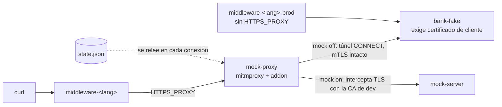
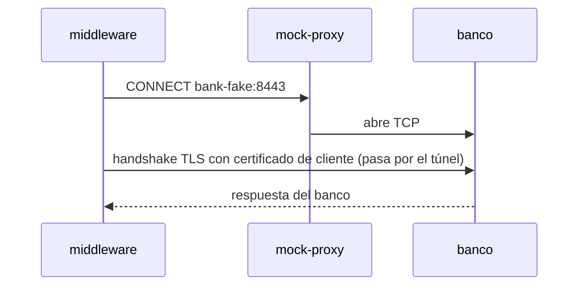
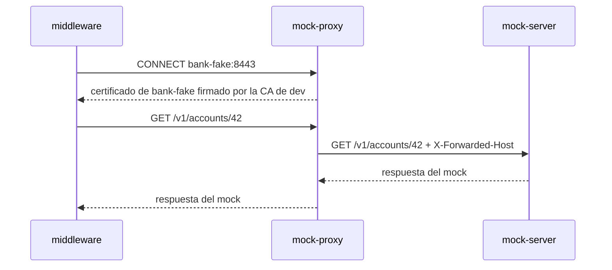

# poc-mock-proxy

Prueba de concepto local: un middleware que llama a un banco por HTTPS con mTLS sale siempre por un forward proxy (`HTTPS_PROXY`). El middleware no tiene lógica de mock. El proxy decide, por host del banco, si deja pasar la conexión o la desvía a un servidor de mocks propio, incluido en este repo (`mock-server/`).

La URL real del banco vive solo en `BANK_BASE_URL` del middleware y no cambia entre un modo y otro.

El mismo middleware está implementado en Python, Go, Java, Rust y .NET para comprobar que el patrón funciona en cada runtime sin cambiar el código del middleware.

## Inicio rápido

```
make test
```

Genera los certificados, construye las imágenes, levanta todo y corre los 25 chequeos (5 casos × 5 lenguajes). No depende de ningún servicio externo.

## Estructura

| Ruta | Contenido |
|---|---|
| `bank-fake/` | banco falso HTTPS con mTLS |
| `mock-server/` | servidor de mocks |
| `mock-proxy/addon.py` | addon de mitmproxy que decide túnel o mock por host |
| `middleware-<lang>/` | middleware en cada lenguaje |
| `state/state.json` | estado del mock por host del banco |
| `scripts/gen-certs.sh` | genera la CA del banco, la CA de dev y los certificados |
| `scripts/build-images.sh` | construye las imágenes de Go, Java, Rust y .NET |
| `scripts/toggle.sh` | prende o apaga el mock |
| `run_poc.py` | corre los casos y muestra el resultado |
| `Makefile` | atajos para todo lo anterior |

## Cómo funciona



Con el mock apagado, el proxy no toca el TLS: el banco ve el certificado de cliente del middleware.



Con el mock encendido, el proxy termina el TLS con un certificado firmado por la CA de dev y reenvía la request al `mock-server`, que responde `{"origin": "mock"}` para `GET /v1/accounts/{id}` y 404 para cualquier otra ruta.



El middleware acepta ese certificado solo porque su bundle de CAs incluye la CA de dev. Sin esa CA, el handshake falla.

## Middlewares

Hay cinco implementaciones con el mismo contrato: `GET /health` y `GET /accounts/{id}`, que llama a `${BANK_BASE_URL}/v1/accounts/{id}`. Ninguna tiene lógica de mock.

Variables de entorno: `BANK_BASE_URL` (obligatoria), `HTTPS_PROXY` (opcional) y `CA_BUNDLE` (por defecto `/certs/bundle-with-dev-ca.crt`; solo se confía en las CAs de ese archivo, no en las del sistema). El certificado de cliente es `/certs/middleware-client.crt` con `/certs/middleware-client.key`.

Respuestas: `200 {"upstream_status", "upstream", "proxy_env"}`; `502 {"error": "upstream <código>", "proxy_env"}` si el banco responde con error HTTP; `502 {"error": "<Tipo>: <mensaje y causa raíz>", "proxy_env"}` ante cualquier otro fallo, que es donde se ve el error del caso e.

| Lenguaje | Directorio | Puertos host (con proxy / sin CA de dev / prod) |
|---|---|---|
| Python | `middleware-python` | 9000 / 9001 / 9002 |
| Go | `middleware-go` | 9010 / 9011 / 9012 |
| Java | `middleware-java` | 9020 / 9021 / 9022 |
| Rust | `middleware-rust` | 9030 / 9031 / 9032 |
| .NET | `middleware-dotnet` | 9040 / 9041 / 9042 |

El puerto del contenedor es siempre 9000.

### Proxy, mTLS y CA propia por runtime

| Lenguaje | Proxy | mTLS y confianza | Error del caso e |
|---|---|---|---|
| Python | `urllib` con `ProxyHandler()` lee `HTTPS_PROXY` | `ssl.create_default_context(cafile=...)` y `load_cert_chain` | `CERTIFICATE_VERIFY_FAILED` |
| Go | `Transport.Proxy = http.ProxyFromEnvironment` | `tls.Config` con `RootCAs` desde `AppendCertsFromPEM` y `LoadX509KeyPair` | `x509: certificate signed by unknown authority` |
| Java | la JVM no lee `HTTPS_PROXY`: se parsea y se pasa a `ProxySelector.of` solo si está definida | `SSLContext` con `KeyStore` en memoria para la clave PKCS#8 (`KeyFactory` RSA) y para las CAs del bundle | `unable to find valid certification path` |
| Rust | `reqwest` lee `HTTPS_PROXY` por defecto | `rustls`, `tls_built_in_root_certs(false)`, un `add_root_certificate` por cada certificado del bundle e `Identity::from_pem` | `UnknownIssuer` |
| .NET | `SocketsHttpHandler` con `WebProxy` armado desde `HTTPS_PROXY` | `RemoteCertificateValidationCallback` con `X509Chain` en `CustomRootTrust` y certificado de cliente re-exportado a PFX | `The remote certificate was rejected by the provided RemoteCertificateValidationCallback` |

## Casos que corre `run_poc.py`

Los cinco casos se ejecutan para cada lenguaje. Los chequeos parsean el JSON y comparan campos; el caso e busca el texto del error TLS dentro del campo `error`.

| Caso | Configuración | Esperado |
|---|---|---|
| a | mock off, con proxy | responde el banco y ve el certificado `middleware-client` |
| b | mock on, con proxy | responde el mock |
| c | mock off otra vez, sin reiniciar nada | responde el banco |
| d | mock on, middleware sin `HTTPS_PROXY` | responde el banco directo |
| e | mock on, middleware sin la CA de dev | error de verificación TLS propio de cada runtime (ver tabla anterior) |

## Servicios

| Servicio | Puerto host | Rol |
|---|---|---|
| `bank-fake` | — | HTTPS en 8443, exige certificado de cliente |
| `mock-server` | — | servidor de mocks en 8080 (`mock-server/server.py`) |
| `mock-proxy` | — | mitmproxy 11.0.2 en 8888 con `mock-proxy/addon.py` |
| `middleware-<lang>` | ver tabla | con `HTTPS_PROXY`, confía en la CA del banco y en la CA de dev |
| `middleware-<lang>-no-dev-ca` | ver tabla | con `HTTPS_PROXY`, confía solo en la CA del banco (caso e) |
| `middleware-<lang>-prod` | ver tabla | sin `HTTPS_PROXY`, confía solo en la CA del banco (caso d) |

## Correr

Con `make`:

| Target | Qué hace |
|---|---|
| `make` / `make help` | lista los targets |
| `make certs` | genera los certificados |
| `make build` | construye las imágenes con `scripts/build-images.sh` |
| `make up` | genera certificados, construye y levanta todo |
| `make down` | baja todo |
| `make test` | corre los cinco casos para los cinco lenguajes |
| `make test-python`, `test-go`, `test-java`, `test-rust`, `test-dotnet` | corre los cinco casos para un solo lenguaje |
| `make mock-on` / `make mock-off` | cambia el estado del mock sin reiniciar |
| `make logs` / `make ps` | logs y estado de los servicios |
| `make clean` | baja todo y borra los certificados generados (conserva `certs/.gitkeep`) |

Sin `make`:

```
python3 run_poc.py
python3 run_poc.py go
python3 run_poc.py go --no-up
```

`run_poc.py` genera los certificados (`scripts/gen-certs.sh`) si faltan, construye las imágenes (`scripts/build-images.sh`), levanta el compose y corre los casos. Informa PASS o FAIL por lenguaje y caso con colores y emojis (se desactivan si la salida no es una terminal o si `NO_COLOR` está definido), un resumen final por lenguaje y sale con código 1 si algo falla. `--no-up` omite el `docker compose up`.

`make test-<lang>` usa `--no-up`: hay que haber corrido `make up` antes.

Para cambiar el estado a mano, sin reiniciar:

```
./scripts/toggle.sh on
./scripts/toggle.sh off
curl localhost:9000/accounts/42
```

## Requisitos

- Docker, `openssl`, `python3` y `make`.

## Limitaciones

- Los middlewares abren una conexión nueva por request (sin keep-alive): el proxy decide por conexión, y una conexión reutilizada seguiría interceptada aunque el mock se apague.
- `scripts/build-images.sh` usa el builder clásico (`DOCKER_BUILDKIT=0`) porque `docker build` con BuildKit se cuelga al terminar la imagen de .NET en el entorno de prueba. En macOS, ese builder consulta el keychain y puede mostrar un aviso de permisos.
- Es una prueba local, no código de producción.
- El estado es por host del banco, no por path ni por cliente.
- Los certificados y las claves se generan en `certs/`, duran 30 días y no se versionan.
- La CA de dev permite hacerse pasar por cualquier host ante quien confíe en ella. No debe estar nunca en el trust store de un entorno productivo.
