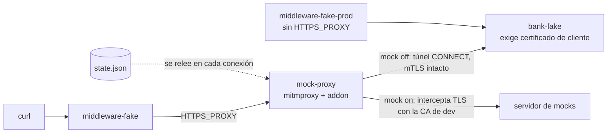
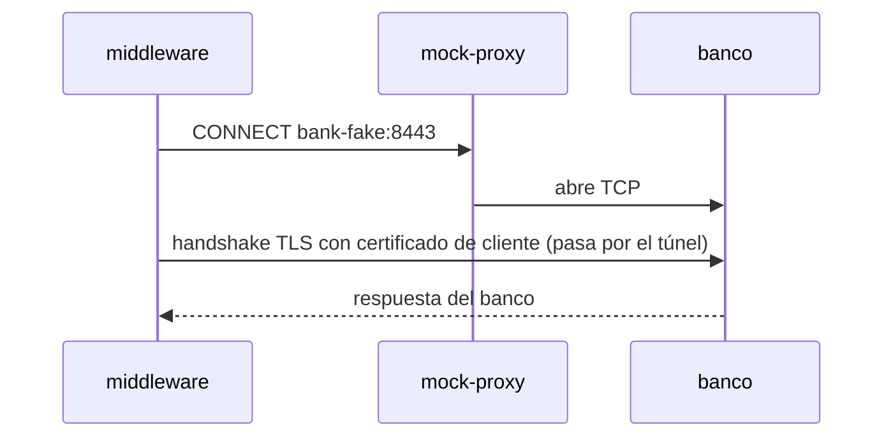
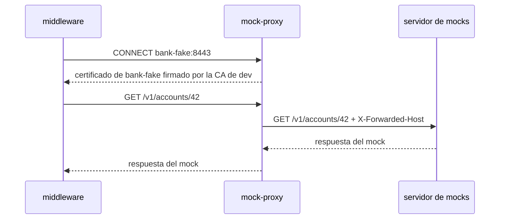

# poc-mock-proxy

Prueba de concepto local: un middleware que llama a un banco por HTTPS con mTLS sale siempre por un forward proxy (`HTTPS_PROXY`). El middleware no tiene lógica de mock. El proxy decide, por host del banco, si deja pasar la conexión o la desvía a un servidor de mocks.

La URL real del banco vive solo en `BANK_BASE_URL` del middleware y no cambia entre un modo y otro.

## Cómo funciona



Con el mock apagado, el proxy no toca el TLS: el banco ve el certificado de cliente del middleware.



Con el mock encendido, el proxy termina el TLS con un certificado firmado por la CA de dev y reenvía la request al servidor de mocks.



El middleware acepta ese certificado solo porque su bundle de CAs incluye la CA de dev. Sin esa CA, el handshake falla.

## Casos que corre `run-poc.sh`

| Caso | Configuración | Esperado |
|---|---|---|
| a | mock off, con proxy | responde el banco y ve el certificado `middleware-client` |
| b | mock on, con proxy | responde el mock |
| c | mock off otra vez, sin reiniciar nada | responde el banco |
| d | mock on, middleware sin `HTTPS_PROXY` | responde el banco directo |
| e | mock on, middleware sin la CA de dev | error `CERTIFICATE_VERIFY_FAILED` |

Los cinco casos pasaron cuando se corrió la prueba (noviembre de 2026).

## Servicios

| Servicio | Puerto host | Rol |
|---|---|---|
| `bank-fake` | — | HTTPS en 8443, exige certificado de cliente |
| `mock-proxy` | — | mitmproxy 11.0.2 en 8888 con `mock-proxy/addon.py` |
| `middleware-fake` | 9000 | con `HTTPS_PROXY`, confía en la CA del banco y en la CA de dev |
| `middleware-fake-no-dev-ca` | 9001 | con `HTTPS_PROXY`, confía solo en la CA del banco (caso e) |
| `middleware-fake-prod` | 9002 | sin `HTTPS_PROXY` (caso d) |

## Correr

```
./run-poc.sh
```

Genera los certificados (`scripts/gen-certs.sh`), siembra el mock (`scripts/seed-mock.sh`), levanta el compose y corre los cinco casos.

Para cambiar el estado a mano, sin reiniciar:

```
./scripts/toggle.sh on
./scripts/toggle.sh off
curl localhost:9000/accounts/42
```

## Requisitos

- Docker y `openssl`.
- Un servidor de mocks externo, que no está en este repo. El compose espera una red Docker externa (`MOCK_SERVER_NETWORK`, por defecto `mock-server_default`) con un servicio `proxy` en el puerto 8080, y `seed-mock.sh` escribe el mock en un contenedor Mongo (`MOCK_SERVER_MONGO_CONTAINER`, por defecto `mock-server-mongo-1`; base `MOCK_SERVER_MONGO_DB`, por defecto `mocks`). Sin esa red el compose no levanta.

## Limitaciones

- Es una prueba local, no código de producción.
- El estado es por host del banco, no por path ni por cliente.
- El servidor de mocks usado identifica al banco parseando `X-Forwarded-Host` como URL, por eso el addon lo manda con esquema (`https://bank-fake:8443`).
- Los certificados y las claves se generan en `certs/`, duran 30 días y no se versionan.
- La CA de dev permite hacerse pasar por cualquier host ante quien confíe en ella. No debe estar nunca en el trust store de un entorno productivo.
